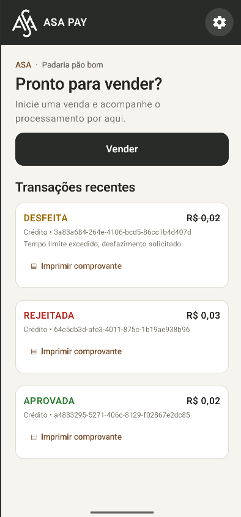
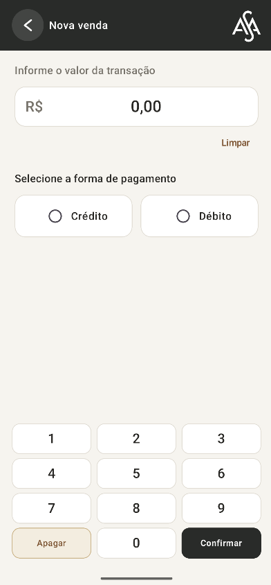
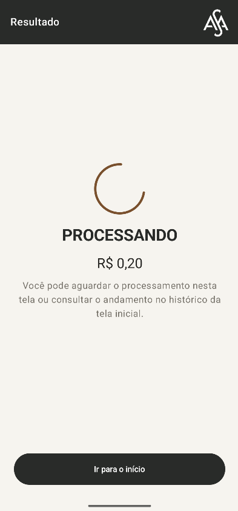
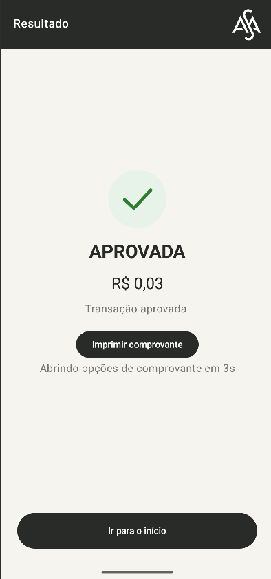
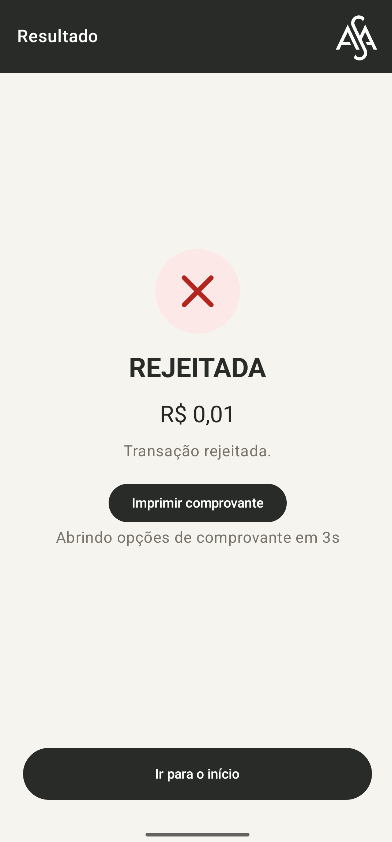
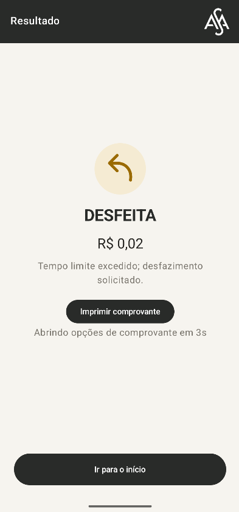
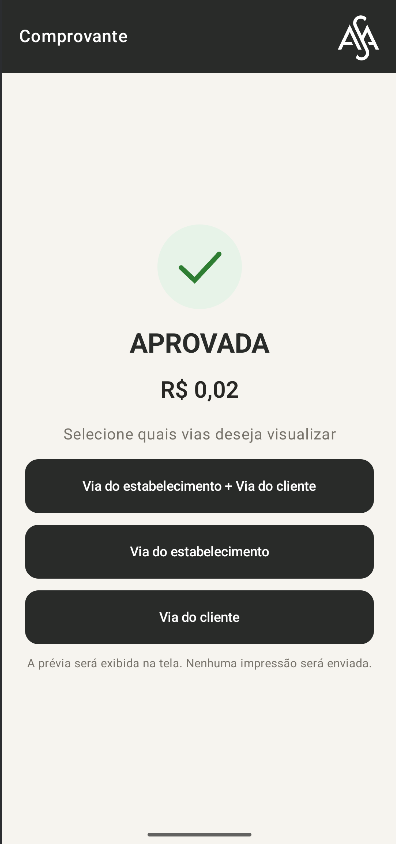
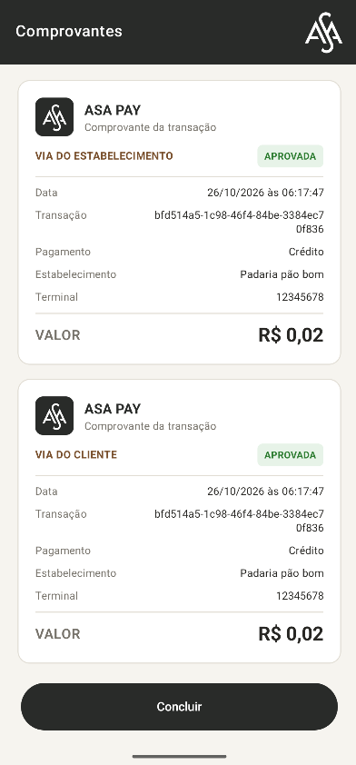
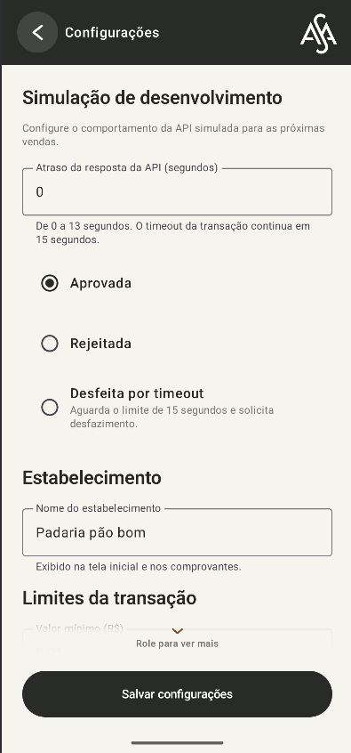
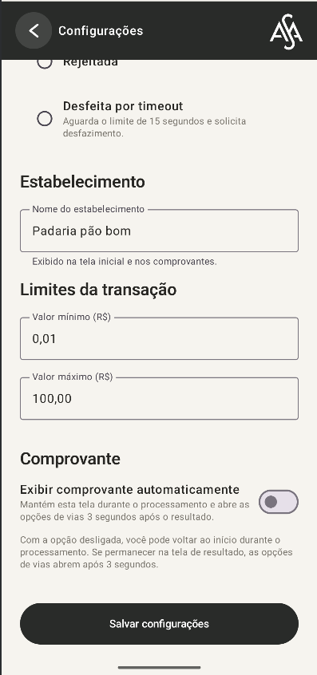

# ASA PAY — SmartPOS

> Protótipo Android em Kotlin para demonstrar um fluxo de venda em SmartPOS: entrada do valor, processamento assíncrono, resultados, histórico em sessão e prévia digital de comprovantes. O modo mock é usado por padrão. O adaptador HTTP e a cifra do payload são implementações de demonstração e ainda precisam ser alinhados e homologados com um backend e um terminal reais.

## Funcionalidades

- Interface Android com Jetpack Compose e identidade visual ASA PAY.
- Ícone do aplicativo com o logo ASA e tela de abertura com imagem de montanhas, logo e slogan “Gerando valor através de gerações”. A passagem do splash para o aplicativo usa uma animação de crossfade.
- Venda por crédito ou débito, com teclado numérico na tela. Os dígitos são interpretados em centavos: `1` corresponde a `R$ 0,01`.
- Validação do valor, forma de pagamento e limites mínimo e máximo configuráveis.
- Nome do estabelecimento configurável. O padrão é **Padaria pão bom**.
- Configurações armazenadas localmente com `SharedPreferences`.
- Processamento assíncrono com status de envio, processamento, aprovada, rejeitada, desfeita ou erro.
- UUID por transação, permitindo associar cada resposta ao registro correto e processar vendas independentes.
- Histórico de transações recentes na tela inicial. O histórico atual fica em memória e não sobrevive ao encerramento do processo do app.
- Opção **Exibir comprovante automaticamente**: quando ativada, impede voltar ao menu inicial durante o processamento e mantém o operador no fluxo até o polling receber o status final da transação. Três segundos depois, abre as opções de vias. Quando desativada, é possível voltar ao menu inicial enquanto a transação continua em processamento, iniciar novas vendas sem esperar o status final da anterior e consultar o andamento no histórico. Se permanecer na tela de resultado, as opções de vias também abrem após três segundos.
- O botão **Imprimir comprovante** na tela de resultado abre as opções de vias imediatamente.
- Comprovantes disponíveis para os resultados finais, com status, via do estabelecimento, via do cliente ou ambas.
- Prévia digital do comprovante na tela. O app não chama uma impressora nem abre o diálogo de impressão do Android.
- Modo de demonstração configurável: aprovação, rejeição, timeout/desfazimento e atraso simulado de 0 a 13 segundos.
- Limite de polling de 15 segundos, iniciado após a autorização, com consulta a cada 500 ms. No timeout, o app solicita `/undo`.

## Fluxo apresentado

As imagens abaixo mostram telas do aplicativo usando o modo mock.

### Início e venda

Na tela inicial é possível iniciar uma venda, abrir configurações e consultar transações recentes. Na tela de venda, informa-se o valor e escolhe-se crédito ou débito.

<table>
  <tr>
    <td align="center"><br><sub>Início e histórico recente</sub></td>
    <td align="center"><br><sub>Valor, pagamento e confirmação</sub></td>
  </tr>
</table>

### Processamento e resultados

Depois da confirmação, a transação aparece em processamento. O modo mock pode demonstrar aprovação, rejeição ou timeout com solicitação de desfazimento.

<table>
  <tr>
    <td align="center"><br><sub>Processando</sub></td>
    <td align="center"><br><sub>Aprovada</sub></td>
  </tr>
  <tr>
    <td align="center"><br><sub>Rejeitada</sub></td>
    <td align="center"><br><sub>Desfeita por timeout</sub></td>
  </tr>
</table>

### Comprovantes

Após o resultado, é possível escolher a via do estabelecimento, a via do cliente ou ambas. A prévia é apresentada na própria tela.

<table>
  <tr>
    <td align="center"><br><sub>Escolha das vias</sub></td>
    <td align="center"><br><sub>Prévia digital</sub></td>
  </tr>
</table>

### Configuração de demonstração

As configurações permitem escolher o resultado simulado da API (aprovação, rejeição ou desfazimento por timeout), definir o atraso da resposta, editar o nome do estabelecimento e configurar os valores mínimo e máximo das vendas. Também é possível ativar a exibição automática do comprovante. Nesse modo, o operador permanece no fluxo até o polling receber o status final da transação; não pode voltar ao menu inicial durante essa espera. Três segundos depois, são exibidas as opções de vias. Com a opção desativada, pode voltar ao menu inicial enquanto a transação continua em processamento, iniciar novas vendas sem esperar o status final da anterior e consultar o andamento no histórico.

<table>
  <tr>
    <td align="center"><br><sub>Cenário de teste, estabelecimento e limites</sub></td>
    <td align="center"><br><sub>Limites e comprovante automático</sub></td>
  </tr>
</table>

## Arquitetura e organização da interface

O projeto usa uma única `MainActivity` como ponto de entrada Android. Ela hospeda o Compose; as telas do fluxo não são Activities separadas.

As telas foram separadas em composables e arquivos por responsabilidade. A navegação é declarada em um `NavHost`, com rotas para início, venda, configurações, resultado e comprovantes. Isso evita concentrar todas as telas em uma única função e permite desenvolver ou ajustar cada área sem misturar sua apresentação com o código das demais.

### Por que Jetpack Compose

Compose foi escolhido porque o app tem uma interface orientada a estados: a tela de resultado muda conforme a transação passa de processamento para aprovada, rejeitada, desfeita ou erro. Com composables observando o estado, a interface pode ser recomposta quando os dados mudam, sem manter manualmente várias Views sincronizadas com o modelo.

Os composables também permitem dividir a interface em peças reutilizáveis e manter a navegação separada da apresentação. Essa organização facilita acrescentar telas, componentes ou ajustes futuros. A escolha não significa que Compose seja sempre mais rápido ou apropriado para qualquer projeto; ele atende bem este fluxo de telas Android dirigido por estado.

### Principais responsabilidades

| Arquivo ou diretório | Responsabilidade |
| --- | --- |
| `MainActivity.kt` | Ponto de entrada Android e hospedagem do conteúdo Compose. |
| `ui/SalesApp.kt` | Configuração inicial, splash, coleta do estado de transações e configurações compartilhadas. |
| `ui/navigation/SalesNavigation.kt` | `NavHost`, destinos e ligação entre eventos das telas e navegação. |
| `ui/navigation/SalesRoutes.kt` | Nomes das rotas e construção de rotas com argumentos, como o ID da transação. |
| `ui/screens/HomeScreen.kt` | Início, ação de venda e histórico recente. |
| `ui/screens/SaleScreen.kt` | Entrada do valor, forma de pagamento e confirmação. |
| `ui/screens/SettingsScreen.kt` | Configuração do estabelecimento, limites e cenário mock. |
| `ui/screens/TransactionResultScreen.kt` | Processamento, resultado, status e temporizador do comprovante. |
| `ui/screens/ReceiptScreens.kt` | Escolha das vias e prévia digital dos comprovantes. |
| `ui/screens/StartupSplashScreen.kt` | Tela de abertura com logo, slogan e imagem. |
| `ui/components/SharedComponents.kt` | Componentes Compose compartilhados entre telas. |
| `ui/PaymentViewModel.kt` | Orquestração assíncrona da venda e publicação dos registros por `StateFlow`. |
| `ui/settings/SalesSettings.kt` | Modelo das configurações e leitura/gravação com `SharedPreferences`. |
| `domain/` | Modelos da venda e transação, status e validação de payload. |
| `data/PaymentApi.kt` | Contrato comum para autorização, polling e desfazimento. |
| `data/MockPaymentApi.kt` | Backend simulado usado por padrão. Não faz chamadas de rede nem cifra payloads. |
| `data/HttpPaymentApi.kt` | Adaptador para as chamadas HTTPS e interpretação das respostas. |
| `data/PayloadCipher.kt` | Cifragem AES-256-GCM do payload de autorização e desfazimento no adaptador HTTP. |

O `PaymentViewModel` depende da interface `PaymentApi`; `MockPaymentApi` e `HttpPaymentApi` implementam esse contrato. Isso permite exercitar o fluxo com o mock e testar o adaptador HTTP sem fazer o ViewModel depender dos detalhes de transporte. Não há uma classe de repositório separada nesta versão.

## Comunicação e criptografia

O app usa o mock por padrão (`USE_MOCK_API = true`). Nesse modo, os resultados e atrasos são simulados dentro do processo. A cifra não é chamada pelo mock.

No adaptador HTTP, os corpos `POST` de `/authorization` e `/undo` são cifrados com **AES-256-GCM**. O código constrói o JSON da venda, valida os campos, cifra os bytes UTF-8 e envia um envelope no formato:

```json
{
  "iv": "...",
  "ciphertext": "...",
  "algorithm": "AES-256-GCM"
}
```

Cada operação de cifragem gera um IV aleatório de 12 bytes e usa uma etiqueta de autenticação GCM de 128 bits. O IV acompanha o envelope e não é a chave. O corpo é enviado por HTTPS; o adaptador rejeita uma URL que use `http://`. O polling é um `GET` por HTTPS com o `transactionId` na query string; ele não passa pelo cifrador AES.

**Limite de segurança:** a chave AES atualmente definida em `app/build.gradle.kts` é uma chave simétrica fixa de demonstração, incluída no aplicativo compilado. Base64 apenas representa a chave como texto e não a protege. Uma chave embutida no app pode ser extraída; portanto, esta configuração não deve ser usada em produção. A integração real precisa acordar com o backend o formato criptográfico e o provisionamento, armazenamento e rotação seguros das chaves. HTTPS continua obrigatório.

### Contrato HTTP esperado

O endereço configurado atualmente é `https://example.invalid/`, um placeholder. Para selecionar o adaptador HTTP, é necessário configurar `USE_MOCK_API = false` e apontar `API_BASE_URL` para um backend HTTPS compatível.

| Método | Caminho | Comportamento esperado |
| --- | --- | --- |
| `POST` | `/authorization` | Recebe o envelope cifrado da venda. |
| `GET` | `/polling?transactionId=...` | Retorna `APROVADA`, `REJEITADA`, `DESFEITA`, `PENDENTE` ou `PROCESSANDO`. |
| `POST` | `/undo` | Recebe o envelope cifrado para solicitar o desfazimento. |

O contrato ainda precisa ser confirmado com o backend: nomes e formatos dos campos, semântica dos status e erros HTTP, idempotência por `transactionId` e significado da resposta de `/undo`. Em caso de falha de comunicação durante autorização, o app tenta `/undo` usando o mesmo ID, mas não consulta o backend para confirmar se a autorização chegou a ser registrada. Retentativas e reconciliação de resultados ambíguos precisam ser definidas com o serviço.

## Testes automatizados (JVM)

Execute os testes JVM com:

```bash
./gradlew :app:testDebugUnitTest
```

No Windows, use `gradlew.bat :app:testDebugUnitTest`. O relatório HTML do Gradle é gerado em `app/build/reports/tests/testDebugUnitTest/index.html`.

O conjunto atual contém **25 testes**:

| Suíte | Qtde. | Cobertura principal |
| --- | ---: | --- |
| `PaymentViewModelTest` | 10 | Aprovação, rejeição, timeout e `/undo`, atraso simulado, vendas simultâneas, erro HTTP 400, falhas na autorização e polling, falha no undo e resposta no limite do timeout. Usa relógio virtual e APIs controladas em memória. |
| `SalePayloadValidatorTest` | 9 | Payload válido e validações de ID, valor, `merchantId` e `terminalId`, incluindo campos vazios, tamanho e caracteres não numéricos. |
| `PayloadCipherTest` | 2 | Recuperação do conteúdo com a chave de teste, IVs novos em cifragens distintas e rejeição de chave que não tenha 256 bits. |
| `HttpPaymentApiTest` | 4 | Teste local do adaptador: corpos cifrados de autorização/undo, mapeamento e codificação do polling, leitura de mensagem HTTP 400 e recusa de URL sem HTTPS. |

`HttpPaymentApiTest` inicia um servidor **HTTPS falso local** durante o teste. O servidor usa um certificado de teste em `app/src/test/resources/asa-test-server.p12`, captura requisições e devolve respostas pré-configuradas. Assim, os testes exercitam o adaptador HTTP real sem acessar um backend externo. Isso não comprova compatibilidade com uma adquirente nem testa integração com hardware. A suíte atual também não contém testes automatizados de interface Compose.

## Limitações e próximos passos de integração

- O modo padrão é mock e o endereço HTTP configurado é apenas um placeholder.
- O histórico de transações fica em memória. Se precisar sobreviver ao encerramento do app, uma camada persistente, como Room, deverá ser adicionada.
- `merchantId` e `terminalId` são valores de demonstração no modelo atual.
- Validações no app melhoram o fluxo, mas o backend também precisa validar todos os dados.
- O projeto não integra leitor de cartão, PIN pad, SDK de adquirente ou impressora física. A tela de comprovante é uma prévia visual.
- A política de idempotência, retentativa, reconciliação após falha de comunicação e confirmação de `/undo` depende do contrato com o backend.
- A janela de polling de 15 segundos começa após a autorização. As chamadas HTTP têm timeout de conexão e leitura de 5 segundos cada; o tempo total percebido pode variar conforme a rede.

## Pré-requisitos e execução local

### Ferramentas

| Ferramenta | Versão/configuração do projeto |
| --- | --- |
| Android Studio | Versão compatível com Android Gradle Plugin 8.7.3 |
| Android SDK Platform | API 35 (`compileSdk` e `targetSdk`) |
| Android Gradle Plugin | 8.7.3 |
| Gradle | 8.9, baixado pelo Gradle Wrapper do projeto |
| Kotlin | Plugin 2.0.21 |
| JDK | 17, também configurado como Gradle JDK no Android Studio |
| Android para executar | API 26 ou superior (`minSdk = 26`), em emulador ou SmartPOS |

### Passos

1. Clone o repositório fornecido para a avaliação ou baixe e extraia o projeto.
2. No Android Studio, abra a pasta raiz, onde está o arquivo `settings.gradle.kts`, e aguarde a sincronização do Gradle.
3. Se o Android Studio solicitar, instale o Android SDK Platform 35 e selecione JDK 17 em **Settings > Build, Execution, Deployment > Build Tools > Gradle > Gradle JDK**.
4. Selecione um emulador ou dispositivo Android/SmartPOS com depuração USB e execute a configuração `app`.

O modo mock está habilitado por padrão, então o app pode ser demonstrado sem credenciais, backend ou hardware de pagamento. A URL HTTP configurada é apenas um placeholder; para usar o adaptador HTTP é necessário configurar um serviço HTTPS compatível, conforme a seção [Contrato HTTP esperado](#contrato-http-esperado).

### Build e testes pelo terminal

Na pasta raiz do projeto, o Gradle Wrapper pode compilar o APK de depuração e executar os testes JVM sem exigir uma instalação global do Gradle:

```bash
./gradlew :app:assembleDebug
./gradlew :app:testDebugUnitTest
```

No Windows, use `gradlew.bat :app:assembleDebug` e `gradlew.bat :app:testDebugUnitTest`. O APK de depuração é gerado em `app/build/outputs/apk/debug/app-debug.apk`.
